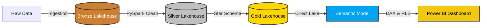

# 🏭 Supply Chain Analytics in Microsoft Fabric

An end-to-end data engineering and business intelligence solution built natively in Microsoft Fabric, designed to track supply chain quality, monitor supplier defect rates, and analyze the financial impact of manufacturing issues.

## 🏗️ Architecture & Tech Stack
* **Platform:** Microsoft Fabric
* **Data Engineering:** PySpark, Notebooks
* **Storage:** OneLake, Delta Parquet (Medallion Architecture)
* **Data Modeling:** Power BI Direct Lake Semantic Model, DAX
* **CI/CD:** Fabric Deployment Pipelines (Dev/Test/Prod), Azure DevOps Git Integration

## 🔄 CI/CD & Lifecycle Management
* Established a full deployment pipeline managing isolated **Development, Test, and Production** environments.
* Integrated with Azure DevOps (Git) for version control, enabling push-button code promotion and enterprise-grade release management.

## ⚙️ Data Pipeline (Medallion Architecture)
1. **Bronze Layer:** Raw supply chain data ingestion.
2. **Silver Layer:** Data cleaning, deduplication, and transformation using PySpark. Handled schema enforcement and timestamp formatting.
3. **Gold Layer:** Star schema optimization. Created `fact_defects` and dimensional tables (`dim_supplier`, `dim_region`, `dim_date`) saved as managed Delta tables.

## 📊 Semantic Model & Security
* Configured a **Direct Lake** semantic model to query OneLake files directly without data duplication or import lag.
* Implemented **Row-Level Security (RLS)** via DAX to restrict regional managers to viewing only defects within their assigned territories.

## 📈 Power BI Dashboard
*(Drag and drop your dashboard screenshot here)*

### Key Metrics Analyzed:
* Total Defect Count & Financial Cost Impact
* Supplier Quality Scorecards
* Regional Defect Distribution
