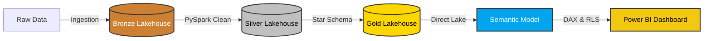

# 🏭 Supply Chain Analytics in Microsoft Fabric

An end-to-end data engineering and business intelligence solution built natively in Microsoft Fabric, designed to track supply chain quality, monitor supplier defect rates, and analyze the financial impact of manufacturing issues.



## 🏗️ Architecture & Tech Stack
* **Platform:** Microsoft Fabric
* **Data Engineering:** PySpark, Notebooks
* **Storage:** OneLake, Delta Parquet (Medallion Architecture)
* **Data Modeling:** Power BI Direct Lake Semantic Model, DAX
* **CI/CD:** Fabric Deployment Pipelines (Dev/Test/Prod), Azure DevOps Git Integration

## 🔄 CI/CD & Lifecycle Management
* Established a full deployment pipeline managing isolated **Development, Test, and Production** environments.
* Integrated with Azure DevOps (Git) for version control, enabling push-button code promotion and enterprise-grade release management.

## ⚙️ Data Pipeline (Medallion Architecture)
1. **Bronze Layer:** Raw supply chain data ingestion.
2. **Silver Layer:** Data cleaning, deduplication, and transformation using PySpark. Handled schema enforcement and timestamp formatting.
3. **Gold Layer:** Star schema optimization. Created `fact_defects` and dimensional tables (`dim_supplier`, `dim_region`, `dim_date`) saved as managed Delta tables.

## 📊 Semantic Model & Security
* Configured a **Direct Lake** semantic model to query OneLake files directly without data duplication or import lag.
* Implemented **Row-Level Security (RLS)** via DAX to restrict regional managers to viewing only defects within their assigned territories.

## 🎯 Business Value
This solution transforms raw, disconnected manufacturing logs into an actionable, enterprise-grade intelligence platform. By centralizing defect data and automating the transformation pipeline, supply chain managers can:
* **Identify High-Risk Suppliers:** Instantly isolate vendors contributing to the highest volume of critical defects.
* **Quantify Financial Impact:** Track the exact cost of quality-assurance failures across different product lines and regions.
* **Secure Regional Data:** Ensure regional directors only access metrics relevant to their specific territories via automated Row-Level Security (RLS).
* **Accelerate Reporting:** Leverage Direct Lake technology to remove data import latency, providing executives with near real-time dashboards.

## 💻 Key Code Highlights

### PySpark: Schema Enforcement & Data Cleansing (Gold Layer)
Cleaned complex data types and dynamically cast timestamps to ensure complete compatibility with the Analysis Services modeling engine:

```python
# Join surrogate keys and format timestamps for Direct Lake compatibility
fact_defects = silver_active_df \
    .join(dim_supplier, on="Supplier", how="left") \
    .join(dim_region, on="PlantRegion", how="left") \
    .select(
        col("DefectID"),
        col("SupplierKey"),
        col("RegionKey"),
        col("Date").alias("DateKey"),
        col("DefectType"),
        col("CostImpact"),
        col("_ingested_at").cast("date") # Standardized for Power BI
    )

# Hard drop to clear metadata cache before overwriting
spark.sql("DROP TABLE IF EXISTS LH_SupplyChain_Gold.fact_defects")
fact_defects.write.format("delta").mode("overwrite").saveAsTable("LH_SupplyChain_Gold.fact_defects")


## 📈 Power BI Dashboard


### Key Metrics Analyzed:
* Total Defect Count & Financial Cost Impact
* Supplier Quality Scorecards
* Regional Defect Distribution
