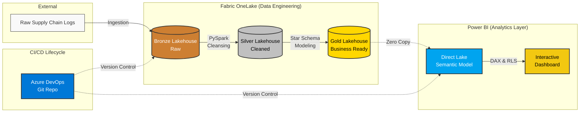

# 🏭 Supply Chain Analytics: End-to-End Microsoft Fabric Project

**Overview:** In this project, we track supply chain quality, monitor supplier defect rates, and analyze the financial impact of manufacturing issues across global plants. The solution centralizes disconnected data, applies strict schema enforcement, and delivers real-time insights to regional directors through a secure, automated pipeline.



The following Microsoft Fabric workloads were utilized for this project delivery:
1. **Data Engineering** (Synapse Data Engineering, PySpark, OneLake)
2. **Data Analysis** (Power BI, Direct Lake Semantic Models, DAX)
3. **CI/CD & Lifecycle Management** (Deployment Pipelines, Azure DevOps)

---

## 🏗️ Project Architecture

Inside the Fabric-enabled workspace, the end-to-end Medallion architecture was established to move data from raw ingestion to business-ready insights.

---

## 1. Workspace & CI/CD Setup
To ensure enterprise-grade development, three isolated workspaces were created: **Development**, **Test**, and **Production**. 
The Dev workspace is backed by Azure DevOps (Git Integration) for version control. A Fabric **Deployment Pipeline** was configured to enable seamless, push-button code promotion across environments, ensuring that production data is never accidentally corrupted by development testing.

## Deployment Pipeline


---

## 2. Data Engineering (Medallion Architecture)
The dataset was extracted, transformed, and loaded using PySpark Notebooks to build a structured Medallion architecture in OneLake. All tables are stored in the optimized Delta Parquet format.

* **Bronze Layer:** Raw supply chain and defect data ingestion.
* **Silver Layer:** Data cleaning and deduplication.
* **Gold Layer:** Star schema optimization. Dimension tables (`dim_region`, `dim_supplier`) and a central fact table (`fact_defects`) were created. 


## Gold Lakehouse SQL Endpoint


## Semantic Model


**Handling Schema Complexities:**
The underlying Analysis Services engine requires strict data types. Using PySpark, complex arrays were flattened, special characters in headers were scrubbed, and ingestion timestamps were explicitly cast to standard dates to ensure semantic model compatibility.

# Overwriting as a managed Delta table
spark.sql("DROP TABLE IF EXISTS LH_SupplyChain_Gold.fact_defects")
fact_defects.write.format("delta").mode("overwrite").saveAsTable("LH_SupplyChain_Gold.fact_defects")
// DAX Snippet: Time Intelligence & High-Impact Analysis
Total Cost Impact = SUM('fact_defects'[CostImpact])

Defects Last Month = CALCULATE([Total Defects], PREVIOUSMONTH('dim_date'[DateKey]))

Critical Defects = CALCULATE([Total Defects], 'fact_defects'[CostImpact] >= 5000)

## Supply Chain Dashboard


```python
# PySpark Snippet: Joining surrogate keys and formatting for Direct Lake
fact_defects = silver_active_df \
    .join(dim_supplier, on="Supplier", how="left") \
    .join(dim_region, on="PlantRegion", how="left") \
    .select(
        col("DefectID"),
        col("SupplierKey"),
        col("RegionKey"),
        col("Date").alias("DateKey"),
        col("DefectType"),
        col("CostImpact"),
        col("_ingested_at").cast("date") # Standardized timestamp
    )
    


